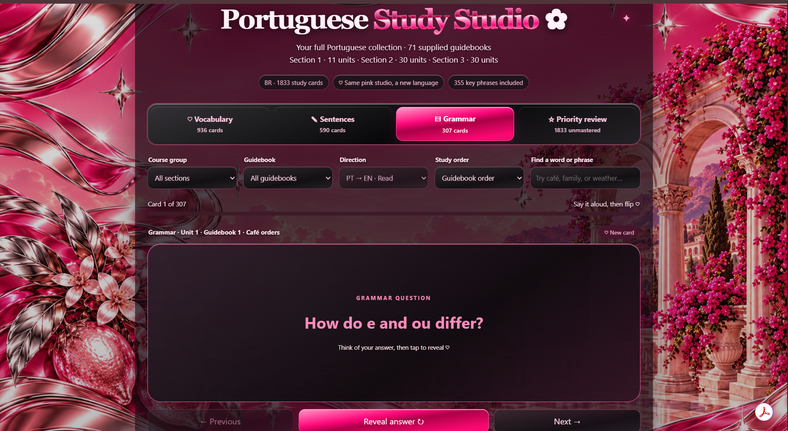
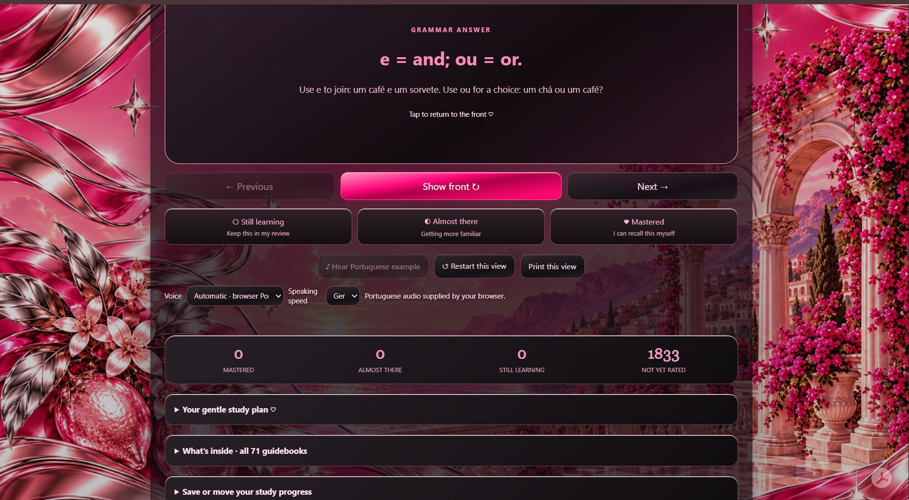

<h1 align="center">✦ Portuguese Study Studio ✦</h1>

  A personalized Brazilian Portuguese language-learning web app built around interactive flashcards, pronunciation support, grammar review, progress tracking, and a mobile-friendly study experience.

  

---

## ✦ Project Overview

Portuguese Study Studio is an interactive language-learning app I created to make Brazilian Portuguese study more organized, visual, and personalized.

The project brings together vocabulary, sentences, grammar, pronunciation practice, progress tracking, search, filtering, and confidence-based review in one place.

It was built around the way I actually study, with a strong focus on usability, mobile access, and making a large amount of content easier to review.

### Live Demo

**[Open Portuguese Study Studio](https://angela-portuguese-flashcards.coppergull1026.chatgpt.site/)**

---

## ✦ Screenshots

### Main Study View

### Progress & Review View

---

## ✦ Features

- 1,833 total Portuguese study cards
- 936 vocabulary cards
- 590 sentence cards
- 307 grammar cards
- 71 guidebooks
- 355 key phrases
- Section and guidebook filtering
- Search by word or phrase
- Portuguese-to-English study mode
- Guidebook-order review
- Interactive flashcards
- Grammar question-and-answer cards
- Pronunciation support
- Browser-based Portuguese speech synthesis
- Adjustable speaking speed
- Self-rating system
- Still Learning, Almost There, and Mastered categories
- Progress tracking
- Priority review
- Study status counters
- Print view
- Restart study view
- Backup and restore tools
- Mobile-friendly layout
- Touch-friendly controls
- Separate Portuguese progress tracking
- Personalized hot pink and chrome visual design

---

## ✦ UX & Product Focus

This project was designed around real study behavior rather than simply displaying vocabulary.

I focused on questions like:

- How can a large study collection stay organized and manageable?
- How can users quickly find the guidebook or topic they want to review?
- How can vocabulary, sentences, and grammar feel connected without becoming cluttered?
- How can pronunciation support be easy to use repeatedly?
- How can difficult cards be prioritized for additional practice?
- How can study progress remain visible without interrupting the learning flow?
- How can the same experience work well on both desktop and mobile?

The app has gone through multiple iterations based on how it actually felt to use during study sessions.

---

## ✦ What I Improved Through Iteration

As the collection grew, I refined the experience to make a large amount of study content easier to navigate.

Improvements included:

- Improved mobile usability
- Increased text readability
- Refined flashcard navigation
- Improved guidebook organization
- Added grammar-specific study cards
- Simplified pronunciation controls
- Added confidence ratings
- Added progress tracking
- Added priority review
- Improved search and filtering
- Separated vocabulary, sentence, and grammar study modes
- Improved visual hierarchy
- Reduced friction during repeated study sessions
- Improved backup and restore functionality
- Improved the overall study workflow

---

## ✦ Technologies & Concepts

  

### Front End

- HTML
- CSS
- JavaScript

### Browser Features

- Speech Synthesis
- Local browser storage
- Interactive UI state
- Progress persistence

### Development Concepts

- Responsive design
- Mobile usability
- UI state management
- Data organization
- Iterative development
- User-centered design
- Product thinking
- Debugging
- Testing

---

## ✦ Skills Demonstrated

This project helped me practice skills beyond basic front-end development:

- User experience design
- Human-centered design
- Responsive web design
- Information architecture
- Product thinking
- Feature iteration
- Browser API integration
- Data organization
- State and progress management
- Mobile usability
- Accessibility awareness
- Visual hierarchy
- Debugging and testing
- User feedback analysis
- Designing for large content sets

---

## ✦ What I Learned

One of the biggest challenges with Portuguese Study Studio was managing scale.

As the project expanded to more than 1,800 study cards across vocabulary, sentences, grammar, sections, and guidebooks, organization became just as important as functionality.

While developing the project, I learned to pay more attention to:

- How large amounts of information should be structured
- How users move through different study modes
- Where unnecessary steps create friction
- How search and filtering can improve usability
- How progress information can motivate users
- How mobile users interact differently from desktop users
- How repeated use reveals design problems
- How small interface changes can significantly improve the overall experience

This project helped me think more like both a developer and a product designer.

---

## ✦ Why I Built It

I am currently learning Brazilian Portuguese and wanted a study tool that matched the way I actually learn.

Traditional flashcard tools did not give me the exact combination of vocabulary organization, guidebook structure, pronunciation support, grammar review, progress tracking, filtering, visual customization, and confidence-based review that I wanted.

So I created my own.

What started as a personal flashcard tool grew into a much larger study system with more than 1,800 cards and 71 guidebooks.

---

## ✦ Study Experience

The app allows me to move between:

- Vocabulary
- Sentences
- Grammar
- Priority review

I can also filter by section and guidebook, search for specific words or phrases, change study direction, rate my confidence, listen to pronunciation, and track which cards I still need to master.

This makes the project feel more like a personalized learning product than a static flashcard deck.

---

## ✦ Future Improvements

Ideas I would like to explore in future versions include:

- Spaced repetition scheduling
- More detailed study analytics
- Study streak tracking
- Session statistics
- More keyboard accessibility
- Additional review modes
- More personalization settings
- Expanded grammar tools
- Improved study recommendations
- More detailed pronunciation controls
- Progress charts and visual analytics
- Smarter review prioritization

---

## ✦ Related Project

I also created a separate Italian Study Studio using a similar concept while keeping each language's content and progress completely independent.

**Italian Study Studio:**  
https://angela-italian-flashcards.coppergull1026.chatgpt.site/

---

## ✦ Author

**Angela Ostorga Coreas**  
Software Engineering Student | UX • Product • Technology

[GitHub](https://github.com/angelacoreas1989-boop) •
[Portfolio](https://angelacoreas1989-boop.github.io/tech-portfolio/) •
[Portuguese Study Studio](https://angela-portuguese-flashcards.coppergull1026.chatgpt.site/)

---

  ✦ <strong>Building technology around real user needs.</strong> ✦

